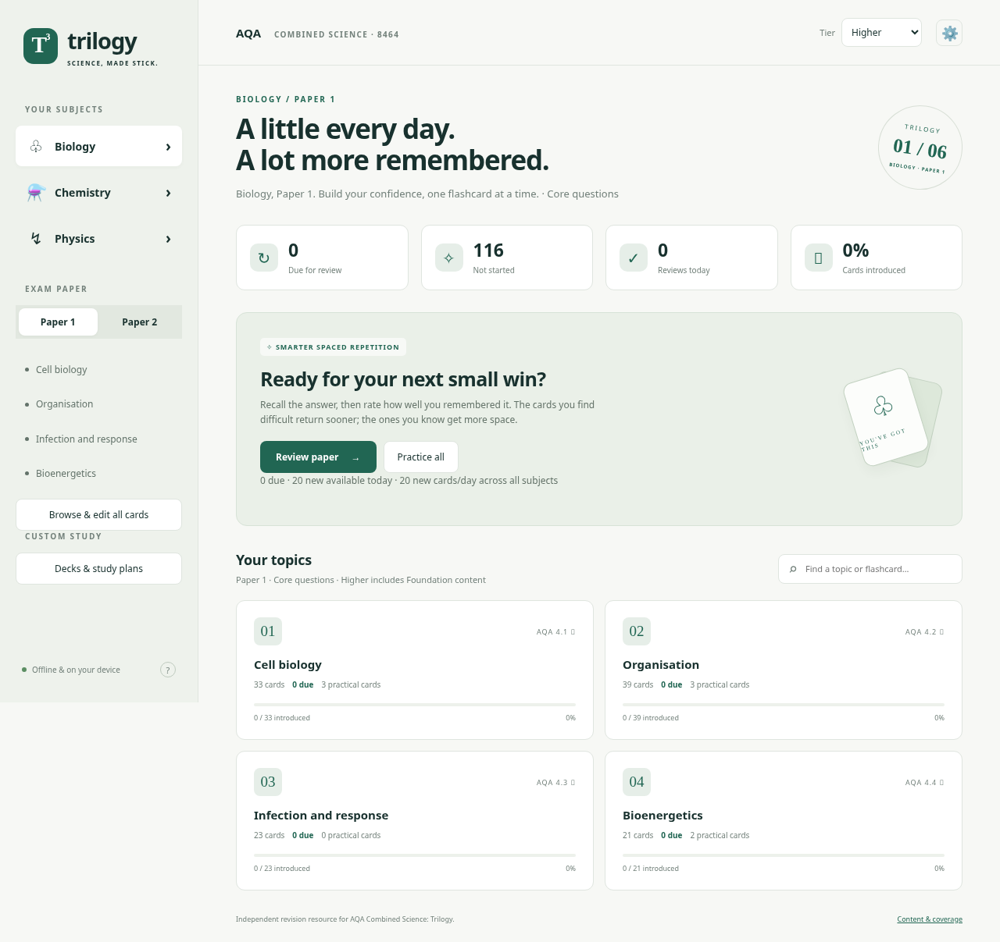

# Trilogy Revision

An offline desktop revision app for **AQA GCSE Combined Science: Trilogy (8464)**, with **641 independently authored flashcards** across Biology, Chemistry and Physics. Each subject is divided into Paper 1, Paper 2 and the relevant AQA topics.



## Download and run

Download `Trilogy-Revision-1.2.0-Windows-x64.exe` from this repository's **Releases** page when the release build has completed. It is a portable Windows x64 executable: run it without installing Node.js or other dependencies. The application is unsigned; no signing certificate has been supplied. It requires a supported Windows version compatible with Electron (Windows 10 or later).

The release workflow builds on Windows and uploads the executable and a SHA-256 checksum. An executable produced locally on Linux is also available in the development environment's `dist/` directory. **Building the Windows artifact does not establish that it has been run on Windows.** See the release status in GitHub Actions; an unfinished or failed workflow does not mean an uploaded release exists.

## Study

1. Choose Biology, Chemistry or Physics, then Paper 1 or Paper 2.
2. Choose Higher or Foundation. Higher includes all Foundation cards; Foundation hides Higher-only material.
3. Review a whole paper or choose a topic. Think of your answer before revealing the concise marking points.
4. Rate your recall: **Again / Hard / Good / Easy**. Difficult cards return sooner; well-remembered cards get longer intervals.

Space reveals an answer; press Space again to rate **Good** and advance. Keys 1–4 choose a rating. Use **Practice all** for an unscheduled pass without changing any intervals. Search finds cards in the selected paper or custom deck. **Undo last rating** restores the previous schedule and review count.

The default is 20 new cards per local calendar day across all subjects, configurable from 0–200 in Settings. Due reviews are not capped. New-card limits do not prevent unscheduled practice. Cards due during an open session become available as their learning delay expires.

In **Settings → Question mode**, choose **Core questions only**, **All questions**, or **Application questions only**. The chosen mode applies to scheduled reviews, practice and study search; the library always allows browsing every card. Existing application-question settings migrate automatically.

Use **Browse & edit all cards** to browse the entire library, filter by subject/paper/topic/type/tier, read answers, edit cards or make your own. Personal cards and edits stay on this device, are labelled during study, and are included in backups. Editing retains the schedule; reverting restores the original built-in card. New cards are assigned to one of the Combined Science topics. Personal content has not been audited against the specification.

Use **Decks & study plans** to select individual cards or whole topics across subjects and papers, including your own cards. A study plan adds chosen weekdays, a start date, an optional target date, and daily new-card/review limits. Each rating counts as a review; ratings of the selected cards in any deck count towards that plan. The global new-card cap also applies. The target date is a goal and does not expire the plan. On unscheduled days or after limits, practice is available without changing schedules.

Card schedules are shared with subject decks; deleting a deck or plan keeps progress. Deleting a personal card removes its progress/history and its membership in selections; empty selections are removed after confirmation. Resetting progress retains personal cards, edits, decks, plans and settings.

## How scheduling works

This is **Anki-inspired SM-2-style scheduling**, not Anki and not an implementation of Anki's FSRS scheduler.

- New/learning cards: Again → 1 minute; Hard → 6 minutes at the first step, otherwise 10 minutes; Good → 10-minute step, then graduation to 1 day; Easy → graduation to 4 days.
- Review cards: Hard grows the interval by 1.2 and lowers ease; Good grows it by ease (initially 2.5); Easy increases ease and grows by ease × 1.3.
- A failed review lowers ease (minimum 1.3), halves the previous interval (minimum 1 day), and returns the card to short learning steps. Successful relearning restores the reduced review interval.
- Due learning/review cards precede new cards. Intervals are stored as absolute timestamps.

## Progress and privacy

Everything runs locally. There are no accounts, telemetry, subscriptions, servers or API keys. Progress is stored in Electron's persistent app storage on this computer (normally under `%APPDATA%/Trilogy Revision` on Windows). Moving or deleting the executable normally leaves that profile intact.

Export a JSON backup from Settings before reinstalling, clearing storage or moving computers. Backups include personal cards, edits, decks, plans and question mode as well as progress. Import validates all of these before offering to replace current data. Legacy backups remain supported; importing one replaces personal content with the data it contains. A reset requires typing `RESET`. Unreadable existing progress is preserved rather than silently overwritten.

## Content scope and verification

This app targets **Combined Science: Trilogy**, not separate/triple GCSEs. Answers are original concise key points, not copied or official AQA mark schemes. Include only points relevant to the exam question and show calculation working and units; no deck can guarantee marks.

The initial course outline was followed by the full saved AQA specification webpage supplied by the user. Its embedded page data contains the complete subject-content and practical sections. The deck was audited against that snapshot on 12 October 2026: all 225 subject-content sections have mapped cards, and all 21 required practical activities are represented. Each card displays its precise specification references.

The audit corrected mixed-section tier boundaries, separated Foundation definitions from Higher explanations, added missing revision coverage and removed unneeded separate-science details. The Higher-tier transformer **power-balance** equation VₚIₚ = VₛIₛ is included because section 6.2.4.3 of the supplied AQA page explicitly requires it. Transformer turns-ratio equations and induction/generator theory are excluded.

This verifies alignment with the **supplied AQA snapshot**, not unseen later website changes. Section coverage is not a claim that flashcards cover every possible exam question. Mathematical application, drawing diagrams, interpreting unfamiliar graphs and supervised practical work still need exam and classroom practice. Personal cards and edited answers are separate from the immutable built-in source and are labelled as unverified personal content.

The `Application questions` directory contains 25 user-supplied PDFs (24 separate-science papers/mark schemes and the 8464 specification). All 952 pages were extracted and reviewed in tracked batches before card changes. Separate-only questions were excluded; one original Biology photograph is absent for copyright reasons and was reported. See [PDF inventory and analysis](docs/PDF-ANALYSIS.md) and [machine-readable checks](docs/pdf-analysis.json). The PDFs are not bundled with the executable.

Official references:

- [AQA Combined Science: Trilogy specification](https://www.aqa.org.uk/subjects/science/gcse/combined-science-trilogy-8464/specification)
- [PDF linked by the supplied AQA webpage](https://cdn.sanity.io/files/p28bar15/green/a18ef3788335dcf75e16c61df6a5149710ec04e8.pdf)
- [Audit findings and topic coverage](docs/COVERAGE.md)
- [Every specification section and its cards](docs/SPECIFICATION-MAP.md)

No space physics; monoclonal antibodies; detailed brain/eye or plant-hormone topics; transition-metal or nanoparticle properties; titrations; percentage yield/atom economy; fuel cells; separate organic reactions; Haber-process production; food-production topic; nuclear fission/fusion; moments; pressure calculations; generators; or transformer turns-ratio calculations. **Fullerenes/graphene, cracking, qualitative National Grid transformer use and the specified Higher-tier transformer power equation belong to Trilogy and are included.**

## Develop

Use the existing checkout: cloud tasks are already isolated; no extra worktree is needed.

Requires Node.js 22 or later and npm. Dependency versions are pinned in `package-lock.json`.

```sh
npm ci
npm run setup
npm start
```

For a browser-only development session (the same interface and local scheduling, stored separately in browser storage):

```sh
npm run serve
```

Open port 4173 locally. The HTTP server binds only to loopback; it is a development helper, not a production service.

```sh
npm test          # scheduler, backup validation, source coverage, tier and scope checks
npm run test:ui   # browser interaction, persistence, backup round-trip, responsive layout
npm run build:win
```

`test:ui` uses `/usr/bin/chromium` by default on Linux. Set `CHROMIUM_PATH` for another Chromium binary. Alternatively install Playwright Chromium with `npx playwright install chromium`. The Windows portable build uses electron-builder/NSIS. Electron 44 downloads its development binary lazily; `npm run setup` prepares it explicitly and respects the environment HTTPS proxy. Build and download caches are directed to the system temporary directory so cloud read-only home directories do not break the build. Package TLS and checksum verification are retained.

The packaged renderer uses a restrictive content-security policy, sandboxing, no Node integration, no external navigation and denied permission requests. The app has no native package dependencies.

## Publish a release

Pushing a `v*` tag triggers `.github/workflows/release.yml` on GitHub. It runs the unit checks, builds a Windows x64 portable executable and publishes it with a checksum using the repository-scoped Actions `GITHUB_TOKEN` and `contents: write`. It exercises the packaged app on Windows before publication and can also be run manually for an existing tag.

```sh
git tag -a v1.2.0 -m "Trilogy Revision 1.2.0"
git push origin main
git push origin v1.2.0
```

Do not claim publication until the release and its assets are visible on GitHub. If Actions is disabled or organisation policy restricts release writes, enable the workflow's permissions or upload the already-built executable through Releases.

MIT-licensed code and original card text. Not affiliated with or endorsed by AQA or Anki.
